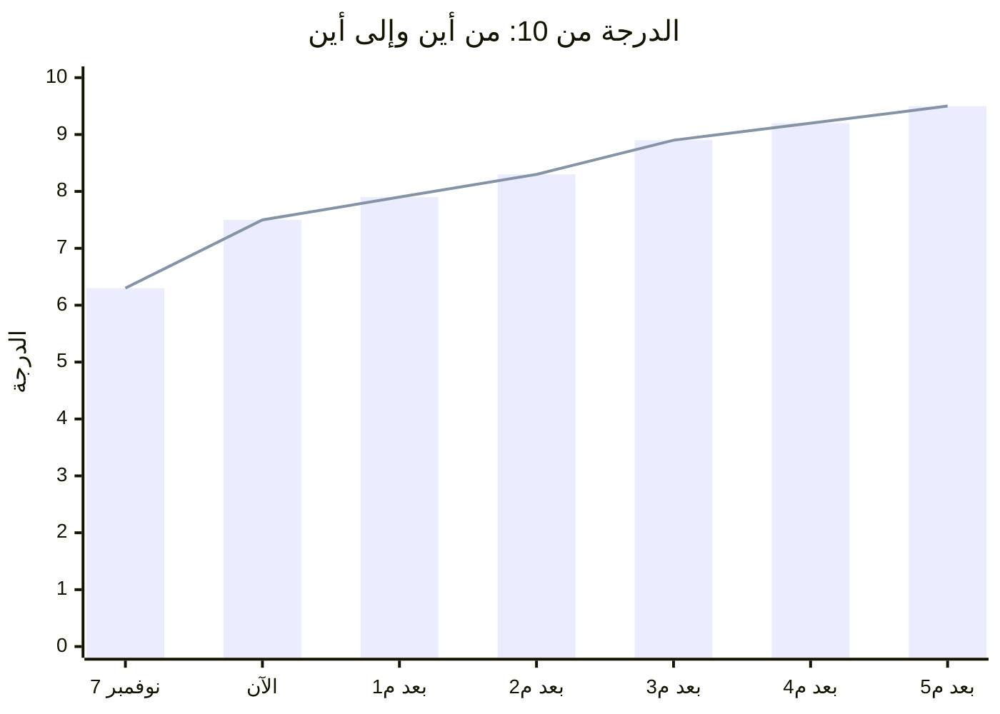
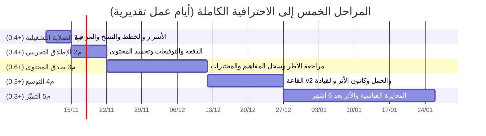
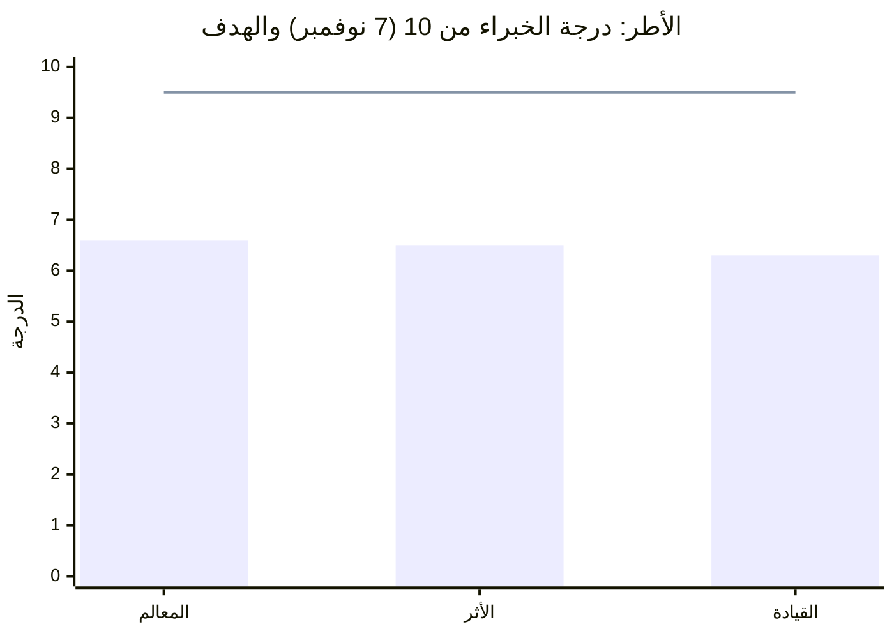
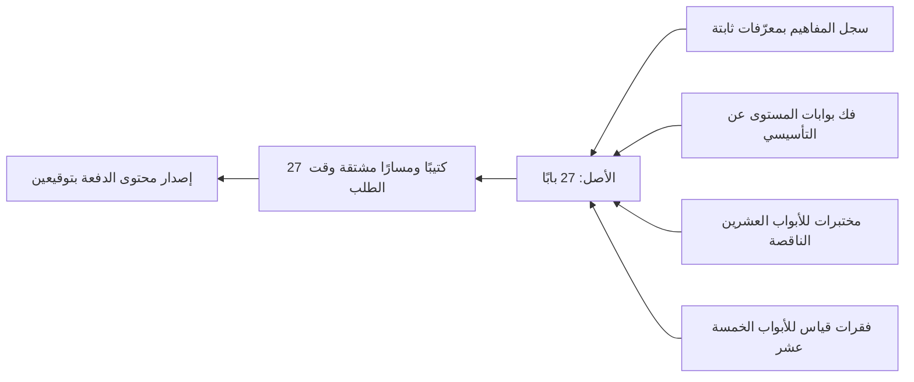

# خريطة الطريق إلى الاحترافية الكاملة (v1)

**التاريخ:** 2026-11-09

**الأساس:**
- التحليل الشامل في 2026-11-07 (`2026-11-07-التحليل-الشامل-للمنظومة-وعيون-الخبراء-v1.md`)، بسبعين وكيلًا ومراجعة اثني عشر خبيرًا.
- ما بُني بعده: الحزم الثلاث عشرة (#204 إلى #218).
- ما نُفّذ اليوم على الإنتاج: الترحيلات 92 من 92، وتفعيل v5، ونشر الدوال الست، ودفع `release` بعد إصلاح CI (#220).

**قراءة الأرقام:**
- أرقام **7 نوفمبر مقيسة** بالتحليل الشامل.
- أرقام **«الآن» تقدير** على الأدلة لما وصل الإنتاج، ولم يُعَد التحليل بعد.
- **الهدف** 9.5 من 10 ونضج 95%. هذا تعريفنا «للاحترافية الكاملة»: مستوى «مُدار ومحسَّن» في نموذج نضج من خمس درجات، أي ممارسات مقيسة ومحروسة آليًا ومراجعة دوريًا.

---

## 1. الوضع العام

| المؤشر | 7 نوفمبر (مقيس) | الآن (تقدير بعد النشر) | الهدف | الفجوة |
|---|---|---|---|---|
| الدرجة العامة | 6.3 من 10 | **7.5** من 10 | 9.5 | **2.0 نقطة** |
| النضج | 2.8 من 5 (53%) | **3.4** من 5 (نحو 66%) | 4.75 من 5 (95%) | **29 نقطة مئوية** |
| الجاهزية لدفعة مدفوعة | مشروط، ونحو 29 يوم عمل | مشروط ببنود المرحلة الأولى | جاهز | 5 مراحل |

**ما رفع الدرجة من 6.3 إلى نحو 7.5:**
- **أُغلق المانع التشغيلي الأول:** عادت فوترة CI، والنشر صار آليًا ومحروسًا.
- **أُغلقت ثغرات الحماية والدفع:** تحقق إشعار Creem، والمقاعد الذرية، والموافقة بالنسخة.
- **صار القياس صادقًا:** طبقة الموازنة v5.2 أزالت قرينة «الصحيح هو الأطول»، والشهادة لا تصدر إلا من اعتماد ختامي.
- **صار للمحتوى حوكمة:** قفل المحتوى المقاس، وتجميده لكل دفعة، وكشف الانحراف.
- **صار للتشغيل وثائقه:** دليل المشغّل، وخطة الحوادث، ومسار الطوارئ.

---

## 2. المراحل المتبقية: خمس مراحل و2.0 نقطة

| المرحلة | المكسب | الدرجة بعدها | أهم المهام | المسؤول |
|---|---|---|---|---|
| **م1 الصلابة التشغيلية** | +0.4 | 7.9 | أسرار الدوال (توقيع الشهادات وسقف البريد والتنبيه)، وترقية Resend وSupabase، ودلو R2 ومفتاح GPG وأول تمرين استعادة، ومراقب خارجي كل 5 دقائق، وإيقاف mi-sspdf، وفرع mi-home | المالك، والتنفيذ من الفريق |
| **م2 الإطلاق التجريبي** | +0.4 | 8.3 | دفعة لكل جهة بمستشارها ومواعيدها، وتوقيع الحدود المؤقتة، وحفظ إعداد الختامي، وقطع إصدار محتوى الدفعة بتوقيعين، والتحقق الحي من مسارات المشارك والخبير والمنسق | المالك والفريق |
| **م3 صدق المحتوى** | +0.6 | 8.9 | سجل مفاهيم بمعرّفات ثابتة، ومراجعة خبراء للأطر الثلاثة، وفك بوابات المستوى عن التأسيسي، وتسييق القطاع العام، ومختبرات للأبواب العشرين الناقصة، وفقرات قياس للأبواب الخمسة عشر | لجنة المحتوى والفريق |
| **م4 التوسع** | +0.3 | 9.2 | القاعة v2 بعد بروفة ق0، واختبار حمل بمئة جهاز، وكاتون لإطاري الأثر والقيادة، وخدمة ذاتية للحذف والتصدير، ورسائل خطأ موحدة | الفريق |
| **م5 التميّز** | +0.3 | 9.5 | معايرة نفسية قياسية (IRT) على بيانات دفعتين، وقياس الأثر بعد ستة أشهر، ومراجعة خارجية مستقلة أمنية وقياسية، ودورة تحسين ربعية | المالك وجهات خارجية |

**مدة م1 وم2 معًا:** نحو 12 يوم عمل حتى دفعة تجريبية. والمسار الحرج فيهما قرارات المالك وتوقيعاته، لا البرمجة.

**مدة م3 إلى م5:** تمتد على دفعتين على الأقل. المعايرة القياسية لا تتم قبل بيانات حقيقية.

---

## 3. المجالات العشرة للمنظومة

```mermaid
xychart-beta
    title "نضج المجالات نحو المثالي (٪): 7 نوفمبر ثم الآن"
    x-axis ["البنية", "المصادر", "الحماية", "التجربة", "التوثيق", "الهندسة", "المحتوى", "القياس", "التشغيل", "القاعة"]
    y-axis "النضج ٪" 0 --> 100
    bar [60, 56, 54, 56, 54, 58, 50, 48, 50, 30]
    bar [65, 72, 70, 58, 72, 70, 60, 66, 65, 33]
```

| المجال | 7 نوفمبر | الآن (تقدير) | ما رفعه | ما يوصله إلى أعلى مستوى |
|---|---|---|---|---|
| البنية والتماسك | 60% | 65% | حارس `verify` يطابق CI، وبناء حتمي (#220) | تقسيم `logic.js` مع بقاء البرميل، وكسر حلقات الاستيراد، وسجل إجراءات مولّد |
| توحيد المصادر | 56% | 72% | قفل المحتوى المقاس، وإصدار الدفعة ببصمات، وكشف الانحراف | مصالحة الحي والمستودع إلى صفر فرق، وبوابة CI ليلية للانحراف |
| الحماية والخصوصية | 54% | 70% | نسخة السياسة والموافقة بسجل لا يُعدَّل، وتحقق المقيّمين، وتهريب البريد | سحب صلاحيات `authenticated` الباقية، وتشفير `totp_secret`، واتفاقيات المعالجة، وخدمة ذاتية للحذف والتصدير، ومراجعة اختراق خارجية |
| تجربة المستخدم | 56% | 58% | الفيديو التعريفي ومعالج البداية | مكوّن خطأ واحد دائم، وموجّه أقسام برابط ورجوع، واختبار SUS مع خمسة مستخدمين لكل دور، وتدقيق WCAG 2.2 AA |
| التوثيق والمعرفة | 54% | 72% | دليل المشغّل، وخطة الحوادث، وصفحة حقائق الجهات، وقائمة المالك | دليلا المنسق والخبير، وسجل قرارات بترقيم عالمي |
| الهندسة والتشغيل | 58% | 70% | CI يعمل، ونشر آلي محروس، وسكربتات النسخ والاستعادة | نسخة ليلية ناجحة خارج GitHub تشمل auth، ومراقب خارجي، وتمرين استعادة شهري، وتنبيه إنفاق |
| منظومة المحتوى | 50% | 60% | مولّد إصدارات الكتاب، وسجل المفاهيم الأولي (73 جدارة) | دليل تحرير للخبراء، وعقد اشتقاق يُفحص عند الحفظ، ومراجعة بشرية موقعة |
| القياس والتقييم | 48% | 66% | v5.2 بلا قرينة طول، والسلّم الرباعي، والشهادة من الختامي، والمختبر مصدر للتقييم المستمر | توقيع لجنة المحتوى، ومقابلات إدراكية، ومعايرة IRT بعد دفعتين، وتحقق هوية المدير والراعي |
| التشغيل والأعمال | 50% | 65% | تحقق Creem، والمقاعد الذرية، والدفع بعد الاعتماد، وعداد البريد | استيراد جماعي ودعوة بالبريد، وسقف بريد بضعف الدفعة، ولوحة إيرادات |
| القاعة | 30% | 33% | نموذج بروفة ق0 | بروفة بخمسة مستخدمين، وحمل مئة جهاز، وحالة مخزنة لكل إصدار |

---

## 4. الأطر الثلاثة

| الإطار | الدرجة | النضج | أقوى باب | أضعف باب | ما تغيّر منذ 7 نوفمبر |
|---|---|---|---|---|---|
| **المعالم** (Milestones) | 6.6 | 62% | الرابع: عمق المفهوم والنماذج (7.2) | السادس: النظام البيئي وجدارات القائد (5.6) | لا تغيير في المتن |
| **الأثر** (Impact) | 6.5 | 50% | الرابع (7.2) | التطبيقات والمختبرات (5.9) | أُزيل «مانح» من أسئلة v5.2 فقط، وبقي في المتن |
| **القيادة** (Leadership) | 6.3 | 52% | الأول: المشهد العالمي (7.1) | السادس (5.4) | لا تغيير في المتن |

### كيف يصل كل إطار إلى أعلى مستوى

**إطار المعالم (6.6 إلى 9.5):**
1. **سد ما يطلبه البنك ولا يعلّمه الكتاب:** إضافة دراسة الجدوى بنموذج الحالات الخمس، والضمان المستقل ومراجعات البوابات، وانحيازات القرار.
2. **إعادة كتابة الباب الثالث:** جودة القرار، والأمان النفسي، ودور الراعي.
3. **تحديث المراجع:** PMBOK 7 بدل مصطلحات 6، ومقارنة PMI وAxelos غير مبسطة.
4. **تصحيح التمايز بين المستويات:** عدد المعالم حسب المستوى في الباب الثالث والسادس.
5. **سد فجوة المؤشرات:** معيار مؤشر ودليل لبعدي «القياس» و«القيمة»، ومؤشرات مؤسسية لا تكافئ الالتزام بالموعد وحده.

**إطار الأثر (6.5 إلى 9.5):**
1. **إعادة التسييق إلى القطاع العام السعودي:** حوكمة الأداء الحكومي ورؤية 2030 و«أداء» بدل ممارسة المانحين، وكلمة «مانح» في خمسة أبواب.
2. **نظرية التغيير بابًا لا سطرين:** فهي نموذج تأسيسي ومتطلب.
3. **حسم صيغة الحد الأدنى للمنفعة ومالكها:** صيغة واحدة ومالك واحد بدل ثلاث صيغ.
4. **مختبرات متوسطة واحترافية:** وإصلاح مختبر `indicator-check` الذي يقبل مؤشرًا بلا موعد.
5. **قيادة الأثر نفسها:** التبنّي، والأمان النفسي في مراجعة المنافع، وجدارات قائد الأثر لكل المستويات لا للاحترافي وحده.

**إطار القيادة (6.3 إلى 9.5):**
1. **توحيد بنية الجدارات:** ثلاث قوائم متعارضة تصير قائمة واحدة بمعرّفات ثابتة في سجل المفاهيم.
2. **تعليم قيادة الذات:** مُعلنة أساسًا ولا يعلّمها أي باب.
3. **إدخال القطاع العام:** الجهة الحكومية، والقيمة العامة، والنزاهة.
4. **فك الحجب عن التأسيسي:** الأمان النفسي العملي وميثاق الفريق ومؤشرات الإتقان محجوبة عن 18 مسارًا من 27، ويُقاس `L-S4` على باب محجوب.
5. **اسم واحد للإطار:** له ستة أسماء الآن.
6. **نظرية تغيير للإطار ومؤشرات نتيجة:** لا مؤشرات زمنية مخرجية وحدها.

**قاعدة حاكمة للأطر الثلاثة:** لا نموذج ولا حقل ولا موضوع ولا فقرة قياس بلا مرجع في باب. يُفرض بحارس في CI على سجل المفاهيم.

---

## 5. المسارات الـ27

المسار تركيب من مستوى المشارك في كل إطار، وكل إطار بثلاثة مستويات: تأسيسي ومتوسط واحترافي، فتكون 3 × 3 × 3 = 27 مسارًا. كتيب كل مسار مشتق من الأصل وقت الطلب، فإصلاح الأصل يرفع المسارات كلها معًا.

### جاهزية خلايا الإطار والمستوى (تقدير على نتائج 7 نوفمبر)

| الإطار | تأسيسي | متوسط | احترافي |
|---|---|---|---|
| المعالم | 🟠 55%: البابان الخامس والسادس محجوبان والمتطلبات تفترضهما | 🟢 68% | 🟢 70% |
| الأثر | 🟠 50%: نظرية التغيير سطران وهي متطلب، ولا مختبرات | 🟠 55%: لا مختبرات متوسطة | 🟠 58%: لا مختبرات احترافية |
| القيادة | 🔴 45%: `L-MAP` و`L-S4` على باب محجوب، والأمان النفسي محجوب | 🟠 55% | 🟢 62% |

**أضعف المسارات:** التي تجمع «تأسيسي» في القيادة والأثر معًا، وهي ثلاثة مسارات. أقواها «احترافي» في المعالم مع «متوسط» أو «احترافي» في غيره.

### ما يرفع المسارات الـ27 كلها

1. **فك بوابات المستوى:** أعلى أثر بأقل جهد. ما يُطالب به التأسيسي أو يُقاس عليه يُدرَّس له، ولو بنسخة مبسطة. يرفع 18 مسارًا مباشرة.
2. **سجل المفاهيم وحارسه في CI:** يُنهي التعارضات بين الأطر في المسارات كلها.
3. **المختبرات والفقرات الناقصة:** 20 بابًا بلا مختبر، و15 بابًا بلا فقرة قياس مبدئي.
4. **تشغيل `verify-tracks-profiles.sql` على الإنتاج، وحسم مصدر هوية المسار:** حذف `profile_key` أو توليده.

---

## 6. المشتقات

| الجزء | 7 نوفمبر | الآن (تقدير) | ما يوصله إلى أعلى مستوى |
|---|---|---|---|
| بنك الأسئلة | 45% | 68% | v5.2 مفعّلة وحارس الطول في CI. يبقى توقيع اللجنة، والمقابلات الإدراكية، والمعايرة بعد دفعتين |
| المسارات الـ27 | 62% | 62% | القسم 5 أعلاه |
| نصوص الرحلة والنماذج | 58% | 68% | السلّم الرباعي الموحد. تبقى مراسي النماذج الـ22، وحماية رموز المتطلبات |
| المختبر | 40% | 42% | مزامنة phase1 وphase2 مع الحي، ونقلها إلى `supabase/content/lab`، ومختبرات الأثر |
| بنك كاتون | 25% | 30% | ربطه بالباب والنموذج، وموضوعات الأثر والقيادة، ثم إعادة إظهاره |

---

## 7. الخلاصة في سطر لكل مستوى

- **اليوم:** الكود والقاعدة والدوال متطابقة على الإنتاج لأول مرة منذ 7 نوفمبر. المنصة نحو 7.5 من 10.
- **بعد م1 وم2، في نحو أسبوعين ونصف:** جاهزة لدفعة تجريبية مدفوعة محدودة.
- **بعد م3:** المحتوى بمستوى مرجعي في الأطر الثلاثة، والمسارات الـ27 متسقة.
- **بعد م4 وم5:** الاحترافية الكاملة 9.5. القياس معاير وأثره مقيس بعد ستة أشهر، بمراجعة خارجية.

**أكبر رافعة منفردة:** م3، صدق المحتوى، بمكسب 0.6 نقطة. أغلبها بيد لجنة المحتوى، لا بيد الفريق الهندسي. لذلك تسمية اللجنة اليوم تختصر المسار أكثر من أي عمل هندسي.
