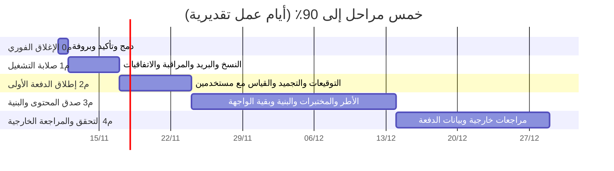

# خطة الوصول إلى 90٪ من النضج والجاهزية (v1)

**التاريخ:** 2026-11-10 · **الطلب:** «خطة ومراحل واضحة للوصول إلى 90٪ من النضج والجاهزية» · **الحالة:** تصور بانتظار اعتماد المالك. لا يبدأ بناء مرحلة قبل اعتمادها.

**الأساس:** خريطة الطريق `2026-11-09-خريطة-الطريق-إلى-الاحترافية-الكاملة-v1.md` (هدفها 95٪ في خمس مراحل)، وما نُفذ في 10 نوفمبر (#230 و#231 و#233)، ووثيقة جلسة تجربة الاستخدام.

**قراءة الأرقام:** أرقام 7 نوفمبر مقيسة. أرقام «الآن» وما بعد كل مرحلة تقدير لا قياس، ويُعاد القياس عند بوابة كل مرحلة. المرحلة لا تُحسب منجزة برقمها بل بمعايير خروجها.

## 1. من أين وإلى أين

| | 7 نوفمبر (مقيس) | الآن (تقدير) | الهدف |
|---|---|---|---|
| متوسط نضج المجالات العشرة | 52٪ | 67٪ | 90٪ |
| أدنى مجال | القاعة 30٪ | منظومة المحتوى 60٪ | لا مجال دون 88٪ |

**ما يعنيه 90٪:** ممارسات مقيسة ومحروسة آليًا، ودفعة حقيقية واحدة مكتملة ببياناتها، ومراجعة خارجية واحدة أمنية. الفرق بينه وبين 95٪ في خريطة الطريق: المعايرة القياسية بعد دفعتين وقياس الأثر بعد ستة أشهر، وهما خارج هذه الخطة.

**المسار الحرج:** قرارات المالك ولجنة المحتوى، لا البرمجة. من 23 نقطة مطلوبة، نحو 14 تتوقف على توقيع أو حساب أو تسمية.

## 2. المراحل

| المرحلة | المدة | المتوسط بعدها | بيد من | ما يوقفها |
|---|---|---|---|---|
| م0 الإغلاق الفوري | يوم | 68٪ | المالك | لا شيء |
| م1 صلابة التشغيل | 5 أيام | 73٪ | المالك، والتنفيذ من الفريق | حسابات مدفوعة ومفاتيح |
| م2 إطلاق الدفعة الأولى | 7 أيام | 79٪ | المالك ولجنة المحتوى والفريق | تسمية اللجنة |
| م3 صدق المحتوى والبنية | 20 يومًا | 86٪ | لجنة المحتوى والفريق | وقت الخبراء |
| م4 التحقق والمراجعة الخارجية | 15 يومًا | 90٪ | المالك وجهات خارجية والفريق | اكتمال الدفعة الأولى |

المجموع نحو 48 يوم عمل، أي عشرة أسابيع إن جاءت القرارات في وقتها. م3 وم4 تتداخلان مع سير الدفعة الأولى.

### م0 الإغلاق الفوري (يوم واحد)

| # | العمل | بيد من |
|---|---|---|
| 1 | دمج #233 (تخفيف حمل القاعة وتقوية الواجهة) | المالك |
| 2 | قراءة أرضية التسكين في اللوحة (50)، وقرار مكتوب فيمن سُكّن قبل رفعها | المالك |
| 3 | بروفة حية للقاعة بخمسة إلى عشرة أجهزة على دفعة العرض | المالك والفريق |
| 4 | مسح ذاكرة Cloudflare لرابطي الفيديو القديمين | المالك |

**معيار الخروج:** #233 على الإنتاج والمسبار أخضر، والبروفة مرّت بلا جهاز على حالة قديمة، وقرار التسكين مكتوب في قائمة المالك.

### م1 صلابة التشغيل (5 أيام عمل)

| # | العمل | بيد من |
|---|---|---|
| 1 | ترقية Supabase إلى خطة مدفوعة | المالك |
| 2 | دلو R2 بأقفال الاحتفاظ، ومفتاح GPG، وأول نسخة ليلية ناجحة، وأول تمرين استعادة | المالك، ثم الفريق |
| 3 | ترقية Resend، وSPF وDKIM وDMARC، و`LEADERS_MAIL_DAILY_CAP` فوق ضعف الدفعة، و`LEADERS_REGISTER_PER_IP_DAY` فوق حجم القاعة | المالك |
| 4 | `LEADERS_ALERT_WEBHOOK` ومراقب خارجي للمسبار كل خمس دقائق، وتنبيه إنفاق Actions | المالك |
| 5 | قبول اتفاقيات معالجة البيانات الأربع وكتابة تواريخها، وتسمية مسؤول حماية البيانات وأدوار خطة الحوادث | المالك |
| 6 | بوابات المراحل (#226) تقرأ ما سبق آليًا وتعرضه في اللوحة | الفريق |

**معيار الخروج:** نسخة عمرها أقل من 30 ساعة خارج GitHub، وتمرين استعادة ناجح مسجل، وتنبيه تجريبي وصل المالك، ولا سر ناقص في النظرة العامة، ومئة رمز دخول في ثلاثين دقيقة تمر في اختبار الحصة.

### م2 إطلاق الدفعة الأولى (7 أيام عمل)

| # | العمل | بيد من |
|---|---|---|
| 1 | تسمية لجنة المحتوى (ثلاثة على الأقل) ومراجع قياسي | المالك |
| 2 | توقيع اللجنة على أداة القياس بعد مقابلات إدراكية وتجربة زمن مع خمسة قادة | اللجنة |
| 3 | توقيع الحدود المؤقتة، وحفظ واحد لإعداد التقييم الختامي | المالك |
| 4 | المصالحة ثم قطع إصدار محتوى الدفعة بتوقيعين | المالك والفريق |
| 5 | إعداد الجهة: 50 مقعدًا، ودفعة جارية بمستشارين اثنين، ومواعيد الجلسات | المالك |
| 6 | استيراد جماعي ودعوة بالبريد للمشاركين | الفريق |
| 7 | بقية المقروئية واللمس (حد 14 بكسل، وتباين الشارات، ومؤشر تقدم واحد)، وقسم «يحتاج تدخلك» في لوحة الجهة | الفريق |
| 8 | استبيان SUS بعد الأسبوع الأول، وجلسة ملاحظة مع خمسة مستخدمين لكل دور | الفريق والمالك |
| 9 | دليلا المنسق والخبير | الفريق |

**معيار الخروج:** أول خمسين مسجلين ومسكَّنين على أداة موقعة وإصدار محتوى مجمّد، وأول جلسة قاعة حقيقية مرّت، ودرجة SUS الأولى مسجلة (الهدف 68 فأعلى)، ولا مسار بلا اعتماد بعد يومي عمل.

### م3 صدق المحتوى والبنية (20 يوم عمل)

| # | العمل | بيد من |
|---|---|---|
| 1 | سجل المفاهيم بمعرّفات ثابتة وحارسه في CI | الفريق واللجنة |
| 2 | مراجعة خبراء للأطر الثلاثة (البنود في خريطة الطريق §4) | اللجنة |
| 3 | فك بوابات المستوى عن التأسيسي: ما يُقاس عليه يُدرَّس له | اللجنة والفريق |
| 4 | مختبرات للأبواب العشرين الناقصة، وفقرات قياس للأبواب الخمسة عشر | اللجنة والفريق |
| 5 | تسييق القطاع العام السعودي في إطاري الأثر والقيادة | اللجنة |
| 6 | تقسيم ملف المنطق الكبير، وكسر حلقات الاستيراد، وسجل إجراءات مولّد | الفريق |
| 7 | أيقونات مرسومة، وطي تبويبات الإدارة، ورئيسية المشارك إلى شاشتين | الفريق |
| 8 | خدمة ذاتية للحذف والتصدير، وسحب الصلاحيات الباقية، وتشفير سر المصادقة | الفريق |
| 9 | بوابة ليلية لانحراف المحتوى الحي عن المستودع | الفريق |

**معيار الخروج:** لا نموذج ولا فقرة قياس بلا مرجع في باب (يفرضه CI)، ولا باب يُقاس عليه محجوب عن مستواه، وتوقيع اللجنة على إصدار المحتوى الثاني، وSUS 75 فأعلى.

### م4 التحقق والمراجعة الخارجية (15 يوم عمل)

| # | العمل | بيد من |
|---|---|---|
| 1 | مراجعة اختراق خارجية بمستوى ASVS الثاني، وإغلاق ما تجده | المالك وجهة خارجية والفريق |
| 2 | تدقيق WCAG 2.2 AA يدوي بقارئ شاشة | جهة خارجية والفريق |
| 3 | القاعة: بروفة بمئة جهاز حقيقي أو على بيئة تجريبية بخطة الإنتاج نفسها | الفريق والمالك |
| 4 | من بيانات الدفعة الأولى: اتساق القرار عند حدود التسكين، ومعادلة الصيغتين، وتقييم مزدوج لعينة 20٪ | المراجع القياسي والفريق |
| 5 | بيئة تجريبية دائمة، وأهداف خدمة مقيسة (زمن الرد والتوافر) | الفريق |
| 6 | لوحة إيرادات، ومراجعة ربعية بالأرقام | الفريق والمالك |
| 7 | إعادة قياس النضج بالتحليل الشامل نفسه | الفريق |

**معيار الخروج:** إعادة القياس تعطي متوسطًا 90٪ فأعلى ولا مجال دون 88٪، ولا ملاحظة أمنية عالية مفتوحة، والدفعة الأولى أنهت قياسها البعدي.

## 3. مسار كل مجال

| المجال | الآن | م0 | م1 | م2 | م3 | م4 | أهم ما يرفعه |
|---|---|---|---|---|---|---|---|
| البنية والتماسك | 65 | 65 | 66 | 68 | 85 | 90 | تقسيم المنطق وسجل الإجراءات (م3)، والبيئة التجريبية (م4) |
| توحيد المصادر | 72 | 72 | 74 | 84 | 88 | 91 | المصالحة وإصدار الدفعة (م2)، وبوابة الانحراف (م3) |
| الحماية والخصوصية | 70 | 70 | 80 | 82 | 86 | 91 | الاتفاقيات والتسمية (م1)، والخدمة الذاتية (م3)، ومراجعة الاختراق (م4) |
| تجربة المستخدم | 64 | 66 | 66 | 76 | 86 | 90 | SUS وجلسات الملاحظة (م2)، وبقية الواجهة (م3)، وتدقيق الوصول (م4) |
| التوثيق والمعرفة | 74 | 74 | 78 | 84 | 88 | 91 | دليلا المنسق والخبير (م2)، وسجل قرارات موحد (م3) |
| الهندسة والتشغيل | 72 | 72 | 84 | 86 | 88 | 92 | النسخ والاستعادة والمراقبة (م1)، وأهداف الخدمة (م4) |
| منظومة المحتوى | 60 | 60 | 60 | 64 | 85 | 89 | اللجنة ومراجعة الأطر وسجل المفاهيم (م3) |
| القياس والتقييم | 68 | 69 | 69 | 78 | 84 | 88 | توقيع الأداة والمقابلات الإدراكية (م2)، وبيانات الدفعة (م4) |
| التشغيل والأعمال | 66 | 66 | 78 | 84 | 87 | 90 | البريد والخطط (م1)، والاستيراد والدعوة (م2)، ولوحة الإيرادات (م4) |
| القاعة | 62 | 70 | 72 | 80 | 84 | 90 | البروفة (م0)، وأول جلسة حقيقية (م2)، وبروفة المئة (م4) |
| **المتوسط** | **67** | **68** | **73** | **79** | **86** | **90** | |

## 4. المخاطر

| الخطر | أثره | ما يخففه |
|---|---|---|
| تأخر تسمية لجنة المحتوى | م2 وم3 تقفان، وهما 13 نقطة من 23 | التسمية في أسبوع م1، قبل أن تُحتاج |
| استقبال الجهة قبل م1 | بيانات خمسين قائدًا بلا نسخة احتياطية | لا يُفتح رابط التسجيل قبل معيار خروج م1 |
| القياس لا يبلغ 88٪ بدفعة واحدة | المتوسط يقف عند 89٪ | مقبول ومعلن: المعايرة الكاملة بعد دفعتين وهي خارج الخطة |
| تعارض عمل الجلسات المتوازية | إعادة عمل وتأخير | قاعدة العمل بالتوازي في `CLAUDE.md`، وطلبات دمج صغيرة تُدمج فور خضرتها |
| الأرقام تقدير | قرار على رقم غير مقيس | إعادة القياس عند بوابة كل مرحلة، والمعيار هو الحكم لا الرقم |

## 5. القرار المطلوب

1. اعتماد المراحل وترتيبها، أو تعديلها.
2. موعد استقبال الجهة: التوصية بعد معيار خروج م1، أي نحو ستة أيام عمل من الاعتماد.
3. تسمية لجنة المحتوى والمراجع القياسي خلال أسبوع م1.
4. الموافقة على مراجعة الاختراق وتدقيق الوصول الخارجيين في م4 (لهما كلفة).
